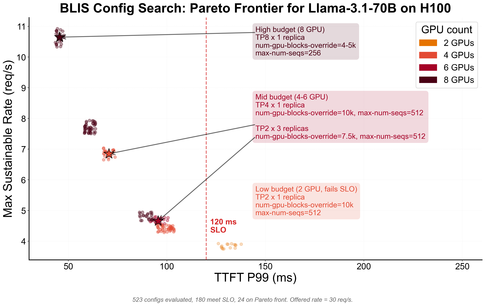

## Capacity planning

Before you deploy, you need to know how many GPUs and which vLLM knobs to set. Each answer used to mean a real-cluster experiment. With BLIS, it's a sweep that runs in seconds per config.

Every dot is a BLIS evaluated configuration. Color encodes GPU count; up-and-to-the-left is better (fast and high-throughput). The 120 ms SLO line splits the space: configs to the left meet the target, everything to the right would page on-call. Arrows point to the best config discovered in each budget tier.

Using multi-objective search, we can discover throughput, latency, and cost tradeoffs easily with BLIS. This experience gives you the ability to deploy only what you feel most confident about.

llm-d-planner, the deployment-recommendation tool for llm-d, is planned to consume BLIS output to power exactly this kind of sizing and policy advice.
